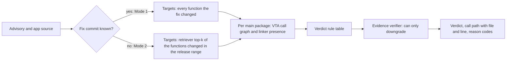

# VulnTrace AI

VulnTrace AI is a triage tool for Go dependency advisories. Given an advisory and a Go application's source, it asks whether a call path exists from the application's `main` package to a function the advisory's fix changed, and it shows the path so a person can check it.

It returns one of three verdicts:

- `REACHABLE`: a call-graph path exists from a `main` package to a target function. It needs a human look; it is not confirmed.
- `NOT_REACHABLE`: two independent analysis methods agree that no path exists.
- `CANT_DETERMINE`: evidence is missing, the analysis failed, the methods disagree, or the verifier rejected the evidence.

**Reachability, never exploitability.** No output says an application can be attacked.

The repository is named `REPO-MIND` for historical reasons (the project began as a codebase-chat idea). Everything runs on free, open models or on none at all; no code, test or script in this repository calls a paid API.

## How it works



- Two reachability methods run on every target: a VTA call graph (a path from `main`) and a linker check (does the symbol survive in a binary built with inlining off). They must agree for `NOT_REACHABLE`; disagreement gives `CANT_DETERMINE`.
- The verifier re-checks every symbol, file, line and call edge of the evidence and can only weaken a verdict.
- A false `NOT_REACHABLE` is the worst error, so every design choice leans towards abstaining.
- Mode 2 `NOT_REACHABLE` is downgraded to `CANT_DETERMINE` by a rule fixed before the results (too few such verdicts to trust).

### Where RAG and LLMs were tried, and what is in the product

| Component | Tried | In the pipeline? |
|---|---|---|
| Hybrid retrieval (BM25, dense embeddings, Reciprocal Rank Fusion), pgvector store | Yes, measured against baselines | Mode 2 ranks candidates with it; the measured end-to-end run used the BM25 fallback because no embedder was available |
| Cross-encoder reranking | Yes | No: it did not help |
| LLM picks the root-cause function (E1, S1) | Yes, two local models | No: E1 lost recall |
| HyDE query rewriting | Yes | No: weak at best |
| LangGraph investigation agent | Yes | No: it did not beat retrieval and cost about five times the tokens |

## Key results

The table below is generated from [docs/results/summary.json](docs/results/summary.json) by `python -m vulntrace results summary`; a test fails if it is stale. Intervals are 95%.

<!-- BEGIN KEY RESULTS (generated by `python -m vulntrace results summary`; do not edit) -->
| Result | Value | Reading |
|---|---|---|
| Mode 2 retrieval beats the commit-message baseline (MRR, hybrid; baseline B-ID) | 0.599 [0.519, 0.683] | baseline 0.397 [0.317, 0.478] |
| ...but hybrid is not clearly better than BM25 (paired MRR difference) | 0.028 [-0.011, 0.065] | no detectable difference |
| An LLM narrowing a fix diff loses recall against keeping every changed function (llama, paired) | -0.271 [-0.337, -0.207] | worse |
| HyDE query rewriting: paired MRR difference (qwen, the one borderline interval) | 0.055 [0.003, 0.110] | better; lower bound barely above zero; one of many uncorrected comparisons |
| The agent against plain retrieval, any-hit@1 (qwen, A2 minus A0) | -0.208 [-0.304, -0.112] | worse |
| Agent cost: prompt tokens per case against the one-shot LLM (llama, A2) | 5.2x |  |
| Fixtures (truth known): false NOT_REACHABLE, Mode 1 | 0 of 22 | truth by construction |
| Fixtures: accuracy, Mode 1 (CANT_DETERMINE counts as not correct) | 18/22 = 0.818 [0.615, 0.927] | truth by construction |
| Real modules analysed as their own app, Mode 2 run: ended in CANT_DETERMINE (D4) | 88 of 120 | a distribution, not accuracy |
| Real applications: NOT_REACHABLE verdicts judged wrong | 0 of 4 | adjudicated by reviewers, not expert ground truth |
| Real applications: REACHABLE paths judged able to run | 0/7 = 0.000 [0.000, 0.354] | judges the shown path, not the target |
| Real applications: govulncheck agreement where both answered | 9/11 = 0.818 [0.523, 0.949] | reference, not truth |

Full table with sources: [docs/results/SUMMARY.md](docs/results/SUMMARY.md).
<!-- END KEY RESULTS -->

Read these with their limits: the fixtures have known truth by construction; the real-application adjudication was done by two Claude reviewer agents reconciled by the supervising assistant, with an owner spot-check of path steps, and is not expert human ground truth; n is small. Details, datasets and threats to validity are in the [final report](docs/FINAL_REPORT.md).

## What did not work

- **An LLM choosing the root-cause function loses recall.** Against "keep every changed function", both local models lowered recall, and a wrongly narrowed pick is exactly the error that could produce a false `NOT_REACHABLE`. The pipeline keeps every changed function in Mode 1.
- **Neural retrieval and reranking do not clearly beat BM25 here.** Commit subjects in the chunk text were the main gain. The retriever ranks candidates; it cannot recover a function that is not a candidate.
- **HyDE is weak.** At most one of many comparisons excludes zero, with no correction for multiple comparisons. It is not used.
- **The investigation agent does not beat plain retrieval and costs about five times the prompt tokens.** The product uses retrieval; the agent stays as a measured negative result.
- **`REACHABLE` paths on real applications are over-approximate.** None of the shown paths could run as a whole, although every step exists in the code. `REACHABLE` therefore means "a call-graph path exists; needs a human look". The official govulncheck was not worse than this pipeline on these cases.
- **The pipeline abstains a lot on real modules**, mostly because modules need a newer Go than the 1.24 toolchain used for the runs, or are libraries with no `main` package.

## Quickstart (offline, on a fixture)

Needs Python 3.11+ and Go 1.24 on `PATH`. The one network step is downloading the Go helper's dependencies; after that nothing needs the network (set `GOPROXY=off` to prove it). No model, GPU or API key is involved.

```bash
python -m venv .venv
```

```bash
.venv/bin/pip install -e ".[dev]"
```

```bash
.venv/bin/python -m vulntrace helper fetch
```

```bash
mkdir -p data/demo && printf '%s' '{"id": "FIXTURE-PARSE", "summary": "vulnlib.Parse mishandles input (synthetic fixture)", "module": "vtfixtures", "fix_commits": []}' > data/demo/fixture_advisory.json
```

```bash
.venv/bin/python -m vulntrace triage --advisory-file data/demo/fixture_advisory.json --app fixtures/reachability --mode targets --target vtfixtures/vulnlib:Parse --main ./cmd/direct_call --out data/demo/fixture_direct_call.json
```

```bash
.venv/bin/python -m vulntrace demo build --verdict data/demo/fixture_direct_call.json --out data/demo/fixture.html
```

Open `data/demo/fixture.html` in a browser: verdict, target, call path with file and line, the verifier's checks. To see a real application, build the page from a committed verdict with no network: see [docs/DEMO.md](docs/DEMO.md).

Run the tests (Python only; Go tests and integration tests need Go):

```bash
.venv/bin/python -m pytest tests/unit tests/contract
```

Regenerate the results summary and the table above from the committed result files:

```bash
.venv/bin/python -m vulntrace results summary
```

## Zero cost

No paid API is used anywhere. Language models run locally through an OpenAI-compatible endpoint (Ollama) or on a free Colab GPU; embedding and reranker models are free open models. Tests never download or call a model; they use deterministic fakes.

## Repository map

| Path | What is in it |
|---|---|
| `src/vulntrace/` | The Python package: pipeline, verdict rule, verifier, retrieval, LLM layer, agent, evaluation and report code |
| `helper/` | The Go helper (call graph, linker queries, lifting, caller/callee queries) with its Go tests |
| `fixtures/` | Synthetic Go modules with known reachability truth |
| `tests/` | Unit, contract and integration tests |
| `docs/results/` | Committed result files, the generated results documents, `SUMMARY.md` and `summary.json` |
| `docs/FINAL_REPORT.md` | The final report |
| `docs/INTERVIEW_NOTES.md` | A pitch and likely questions with evidence links |
| `docs/DEMO.md` | Offline demo commands |
| `docs/architecture/`, `docs/design/`, `docs/decisions/` | Design documents and decisions (design history, see the notes in them for what was superseded) |
| `docs/evaluation/`, `docs/testing/` | Evaluation plan, dataset strategy, testing strategy |
| `docs/progress/` | Checkpoint ledger, per-checkpoint reports, supervisor handoff |
| `notebooks/` | Colab notebooks for the model runs |
| `CLAUDE.md`, `prompts/` | The rules and the session wrapper the build followed |

## Build process

The project was built one checkpoint at a time by Claude Code under the rules in [CLAUDE.md](CLAUDE.md), with a separate supervising assistant reviewing each checkpoint before the next was released. The ledger is [docs/progress/STATUS.md](docs/progress/STATUS.md); each checkpoint has a report in `docs/progress/reports/` and the reviewers' verdicts are at the end of each file in `docs/implementation/checkpoints/`.

## Licence

No licence file is committed, so no licence is granted for reuse of this repository's code yet; choosing one is an open decision for the owner. Advisory data comes from the Go vulnerability database (`golang/vulndb`), whose data is CC-BY-4.0 and whose code is BSD-style; the repository commits only advisory IDs, dates, counts and statuses, never advisory text (see `vulndb.json`).
