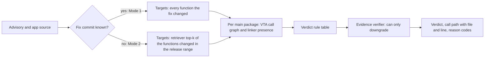

# VulnTrace AI: final report

This report states what VulnTrace AI does, how it is built, what was measured, what worked, what did not, and why. Every number in it comes from [docs/results/summary.json](results/summary.json), which is computed by code from the result files committed under `docs/results/`; the same numbers with their sources are in [docs/results/SUMMARY.md](results/SUMMARY.md). A test fails if a number here is not in the summary. The per-checkpoint reviews by the supervising assistant, which bind what this report may claim, are at the end of each file in `docs/implementation/checkpoints/` (CP3 to CP7b).

**Reachability, never exploitability.** A verdict says whether a call path from a `main` package to a function exists in the call graph. No output says an application can be attacked.

## 1. Summary

- **What it is.** A Go advisory triage tool. Given an advisory and an application, it analyses whether the application's `main` package can reach the functions the advisory's fix changed, with two independent methods, and prints the path with file and line. It abstains (`CANT_DETERMINE`) whenever the evidence is missing, the methods disagree, or a deterministic verifier rejects the evidence.
- **Where machine learning went.** Retrieval, local LLM selection, HyDE and a LangGraph agent were each built and measured against a simpler baseline. Retrieval is in the product for Mode 2; the other three are not, because they did not beat the baseline.
- **Safety result on fixtures** (truth by construction): 0 of 22 false NOT_REACHABLE in Mode 1; the evidence verifier rejected 36 of 36 deliberately corrupted paths and 0 of 12 correct outputs.
- **Result on real applications** (14 cases, 5 applications): 0 of 4 NOT_REACHABLE verdicts were wrong, but the shown REACHABLE paths were over-approximate: none of 7 could run as a whole. REACHABLE therefore means "a call-graph path exists; needs a human look". On these cases the official govulncheck was not worse than this pipeline.
- **Negative results kept as results:** an LLM choosing the root-cause function loses recall (E1); neural retrieval and reranking do not clearly beat BM25; HyDE is weak; the agent does not beat retrieval and costs about five times the prompt tokens.

## 2. Problem and scope

Dependency scanners report every known vulnerability in every dependency version an application uses, and most reports do not matter because the application never calls the vulnerable code. Go has a reachability tool, govulncheck, but it can only check reachability when the advisory names vulnerable functions ("symbols"), and about four in five live Go advisories list none. That figure is a pre-design measurement ([feasibility findings](research/FEASIBILITY_FINDINGS.md), trial 1); it was not re-measured here. VulnTrace AI targets that gap: recover candidate functions from the fix commit or the release range, decide reachability by program analysis, show evidence, and abstain honestly.

Three terms are never mixed up: *presence* (the module version is in the dependency graph), *reachability* (a call path exists; this tool), *exploitability* (an attacker can trigger the flaw; out of scope, left to a human). The full definition is in [docs/PROJECT_DEFINITION.md](PROJECT_DEFINITION.md).

Scope: Go only; one build configuration (linux/amd64, `CGO_ENABLED=0`, no build tags); static analysis only, so nothing from an analysed application is executed; no exploitability, no other ecosystems, no hosted service.

## 3. The system as built

- **Targets.** Mode 1 (a fix commit is known) analyses every non-test function the fix changed. Mode 2 (no fix commit) ranks the functions changed between the vulnerable and the first fixed release with a retriever and analyses the top-k. A Mode 2 REACHABLE is labelled candidate level, because a reachable changed function need not be the vulnerable one.
- **Two reachability methods per target and main package.** A VTA call graph (`golang.org/x/tools`) finds a path from `main`/`init`; a linker check builds with inlining off and asks whether the symbol survives in the binary. The rule table: both say reachable gives REACHABLE; both say absent gives NOT_REACHABLE; any disagreement or error gives CANT_DETERMINE. The full table is in [docs/architecture/SYSTEM_ARCHITECTURE.md](architecture/SYSTEM_ARCHITECTURE.md).
- **Evidence verifier.** It re-checks every symbol, file, line and call edge cited by a verdict and can only weaken it.
- **Mode 2 NOT_REACHABLE policy.** A Mode 2 NOT_REACHABLE only says that none of the analysed top-k candidates is reachable, and the candidate list misses the labelled function in some cases. A rule fixed in code before the results keeps such a verdict only with at least 20 raw verdicts on D4 and a tight upper bound; D4 produced 5 of 20, so the policy downgrades them to CANT_DETERMINE.
- **What is not in the pipeline.** LLM root-cause selection, HyDE, reranking and the agent were measured and left out (sections 5 and 6). Lifting to exported entry points exists as a helper mode and an evaluation, but never decides a verdict.
- **Safety and cost.** Analysed code is untrusted: builds use `GOTOOLCHAIN=local` and `CGO_ENABLED=0`, and `go generate`, target tests and target binaries are never run. No paid API is used anywhere; models are local or on a free Colab GPU, and tests use deterministic fakes.

## 4. Datasets and their limits

| Dataset | What | Size | Limits that matter |
|---|---|---|---|
| D2 fixtures | Synthetic Go modules, one `main` per case, truth by construction | 22 cases | Written by the same author as the methods; they show where each method breaks, not an accuracy estimate for real code |
| D1 | Mode 1 evaluation: advisories with a fix commit, sampled from 506 eligible (a pinned snapshot of the Go vulnerability database) | 150 sampled, 146 with evidence | Labels are the curators' symbols, whose convention differs from "the function the fix edited" in some cases |
| D4 | Mode 2 evaluation: the same eligibility with the fix commit hidden; candidates are the functions changed in the release range | 120 cases from 94 distinct ranges | 9 cases share one identical range (pseudo-replication; intervals resample ranges); 87 of 120 were created after the 2026-06-30 cut-off and 14 have no date (date skew); 14 cases have ranges truncated at the commit limit; 19 of 120 have no labelled function among the candidates, which caps any ranking |
| D3 | Real applications with adjudicated truth | 14 cases from 5 applications | Small n; cases of one application are dependent; adjudication is not expert ground truth (section 6.9) |

The case lists are committed ([D1](results/datasets/D1_cases.json), [D4](results/datasets/D4_cases.json)); bulky evidence is rebuilt by code and never committed. The contamination split uses each model's documented training cut-off; one model's cut-off is taken from third-party copies of its model card and the other's is undocumented, so every dated case counts as possibly seen for the second model. Cross-model comparisons are indicative only.

## 5. Design decisions and the measurement behind each

| Decision | Measured by | Review notes |
|---|---|---|
| Two independent methods, abstain on disagreement | Fixtures: each method alone errs, the combination does not (CP2 table); distributions on real modules (CP7) | [CP2 results](results/CP2_CALLGRAPH_RESULTS.md), [CP7 review](implementation/checkpoints/CP7.md#review-notes) |
| Linker check with inlining off | Three fixtures flip to ABSENT with inlining on (CP1) | [CP1 results](results/CP1_LINKER_RESULTS.md) |
| Mode 1 keeps every changed function; no LLM narrowing | E1 (section 6.3) | [CP5 review](implementation/checkpoints/CP5.md#review-notes) |
| Mode 2 uses retrieval top-k, not the agent | CP4 retrieval and CP6 agent (sections 6.2, 6.7) | [CP6 review](implementation/checkpoints/CP6.md#review-notes) |
| Mode 2 NOT_REACHABLE is downgraded | 5 of 20 required raw verdicts on D4 (CP7) | [CP7 review](implementation/checkpoints/CP7.md#review-notes) |
| Verifier is deterministic and downgrade-only | Corrupted-path probe; false rejections found on real modules and fixed (CP7) | [CP7 results](results/CP7_TRIAGE_RESULTS.md) |
| Lifting is a candidate-widening aid, outside the verdict path | CP5b coverage and scores | [CP5b review](implementation/checkpoints/CP5b.md#review-notes) |
| REACHABLE is presented as "needs a human look" | D3 adjudication: no shown path could run (CP7b) | [CP7b review](implementation/checkpoints/CP7b.md#review-notes) |
| Zero cost, fakes in tests | Rule from the start; tests never call a model | [CLAUDE.md](../CLAUDE.md) |

The architecture and decision documents ([architecture](architecture/SYSTEM_ARCHITECTURE.md), [decisions](decisions/ARCHITECTURE_DECISIONS.md)) are design history written before the experiments; where an experiment overturned a design choice (LLM selection, the agent, a multi-agent variant), the document carries a note saying so.

## 6. Experiments

Intervals are 95%; they are cluster-bootstrap intervals except for the fixture, D3 and count rows, which use Wilson intervals or none (stated in [SUMMARY.md](results/SUMMARY.md)). "Better" or "worse" below means the paired interval excludes zero; anything else is "no detectable difference".

### 6.1 Reachability methods on the fixtures (CP1, CP2, CP7)

- **Question.** Does combining a VTA call graph with a linker check give correct verdicts where the truth is known?
- **Setup.** The 22 synthetic fixtures, three modes: a given target, Mode 1 with a synthetic fix commit, Mode 2 with a synthetic release range that also changes an unrelated function.
- **Result.** Mode 1: 0 of 22 false NOT_REACHABLE, 0 of 22 false REACHABLE, 4 of 22 CANT_DETERMINE, accuracy 18/22 = 0.818 [0.615, 0.927] (CANT_DETERMINE counted as not correct). Mode 2: 4 of 22 false REACHABLE, by construction (an unrelated function changed in the same range is reachable), and accuracy 12/22 = 0.545 [0.347, 0.731]. The verifier rejected 36 of 36 corrupted paths and 0 of 12 correct outputs.
- **What it changed.** The abstention rule was kept: the safe errors (CANT_DETERMINE) are cheap and the dangerous one (false NOT_REACHABLE) did not occur. Mode 2 answers are labelled candidate level. Fixtures have known truth by construction, so this says where the methods break; it is not an accuracy estimate for real code.

### 6.2 Mode 2 retrieval on D4 (CP4)

- **Question.** Do hybrid search (BM25 plus dense embeddings, Reciprocal Rank Fusion), a cross-encoder reranker and a PostgreSQL + pgvector store find the labelled function among a release range's changed functions better than simple baselines?
- **Setup.** 120 D4 cases, 31 runs on a free T4 GPU and on CPU; random order, size order and a commit-message identifier search (B-ID) as baselines; chunks with and without commit subjects; an ID-masked control.
- **Result.** Retrieval clearly beats B-ID: MRR 0.599 [0.519, 0.683] for hybrid against 0.397 [0.317, 0.478]. But BM25 reaches 0.571 [0.495, 0.651], and the paired differences are dense against BM25 0.032 [-0.023, 0.084], hybrid against BM25 0.028 [-0.011, 0.065] and hybrid against dense -0.003 [-0.042, 0.039]: no detectable difference. Rerankers do not help (MiniLM rerank against hybrid -0.018 [-0.070, 0.034]; bge-reranker -0.034 [-0.103, 0.038]). A code-search embedder with a short input limit is worse than bge-small (-0.137 [-0.208, -0.060]). Commit subjects in the chunk text are the main gain (hybrid +0.073 [0.026, 0.121]); masking advisory IDs changes nothing, but the control is weak because no query contains an ID. On the 38 cases with more than 100 candidates BM25 reaches 0.523 [0.363, 0.659] and hybrid 0.590 [0.413, 0.739] against B-ID 0.211 [0.052, 0.362].
- **What it changed.** Ranking is useful but not solved, and neural retrieval is not clearly better than BM25 on this data. Mode 2 keeps the hybrid retriever as the intended ranker with BM25 as the documented fallback, the reranker was dropped from the design, and the ceiling (19 of 120 cases have no labelled function among the candidates) motivated the lifting experiment.

### 6.3 E1: an LLM picks the root-cause function from a fix diff (CP5)

- **Question.** Does a local LLM, shown the advisory and the diff, choose the vulnerable function better than predicting every changed function (E0)?
- **Setup.** D1, two local 7 to 8 billion parameter models through Ollama, frozen prompts, temperature 0, headline group of cases created after each model's documented cut-off.
- **Result.** Precision rose slightly for one model (paired +0.048 [0.009, 0.086]), but recall fell from 0.840 [0.774, 0.901] to 0.569 [0.490, 0.643] (paired -0.271 [-0.337, -0.207]); F1 -0.067 [-0.112, -0.025] and any-hit -0.099 [-0.161, -0.045] are worse. The second model is similar: recall paired -0.289 [-0.356, -0.224].
- **What it changed.** A wrongly narrowed pick is exactly the error that could produce a false NOT_REACHABLE later, so the pipeline does not let an LLM narrow Mode 1: every changed function is analysed. The LLM selector stays in the repository as a measured negative result.

### 6.4 S1: an LLM chooses from the retriever's top-k (CP5)

- **Question.** Does an LLM choosing among the top-10 or top-5 retrieved candidates beat taking the top-1?
- **Result.** One model improves on top-1 when its gold is among the top-10: any-hit 0.716 [0.578, 0.841] against 0.622 [0.500, 0.743], paired +0.095 [0.030, 0.163]. The other is worse (paired -0.312 [-0.430, -0.197]) because it abstained on 76 of 118 cases; the frozen prompt invites abstention, so this measures instruction following, not code understanding.
- **What it changed.** Nothing in the pipeline: a gain for one model over top-1 does not justify an LLM stage whose failure mode is silent narrowing. The prompt was not tuned on these cases; a prompt change would need a fresh case set.

### 6.5 HyDE query rewriting (CP5)

- **Question.** Does a hypothetical Go function written by the LLM improve retrieval when used as an extra query?
- **Result.** One model: paired MRR +0.035 [-0.050, 0.117], no detectable difference (0 of 32 comparisons exclude zero). The other: +0.055 [0.003, 0.110], whose lower bound is barely above zero, and only 2 of 24 comparisons exclude zero, with no correction for multiple comparisons.
- **What it changed.** HyDE is not in the pipeline. A single borderline interval among many comparisons is not a finding.

### 6.6 Lifting and caller/callee queries (CP5b)

- **Question.** Can a call-graph walk from a changed internal function to its exported callers recover the curators' derived symbols, and can graph expansion rescue the Mode 2 ceiling?
- **Result.** Lifting worked on 86 of 99 D1 cases that have derived symbols. New-symbol precision and recall against the curators: NEAREST rule 0.727 [0.613, 0.837] and 0.253 [0.186, 0.327]; ALL rule 0.473 [0.359, 0.587] and 0.466 [0.369, 0.569]. Adding lifted symbols to the E1 selection beats E1 (F1 +0.070 [0.032, 0.111] for one model) but not E0 (+0.002 [-0.050, 0.054]). On the D4 ceiling a candidate lies within 1 hop in 1 of 17 cases and within 2 hops in 4 of 17.
- **What it changed.** Lifting is a candidate-widening aid and never decides a verdict; E1+L is not presented as an improvement over the baseline; the agent's caller/callee tools are an ablation, not a promised gain. These runs used go1.26.10 fetched into a scratch directory because many modules need a newer Go than CI's, so they are not reproducible inside CI.

### 6.7 The LangGraph investigation agent (CP6)

- **Question.** Does an agent that can search, read diffs and walk callers/callees pick the vulnerable function better than the retriever's top-1 (A0), and at what cost?
- **Setup.** D4, the same two models, arms A0 (retrieval), A1 (one-shot LLM), A2 (agent), A3 (agent with graph tools); frozen prompts and budgets; one run per configuration.
- **Result.** The agent does not beat retrieval. For one model A2 and A3 equal A0 at top-1 (A2 minus A0 0.000 [-0.082, 0.082]). For the other, A2 is worse than A0 (-0.208 [-0.304, -0.112]) and A3 shows no detectable difference (-0.085 [-0.163, 0.000]); that model's only win is A3 over the one-shot arm (+0.151 [0.056, 0.248]), a baseline that answered only 0.350 of cases. Cost: about 5.2 times the prompt tokens and 2.1 times the seconds of the one-shot LLM (A2, first model). The loop rule ended 40 of 118 A2 runs of the second model without an answer, and in 18 of those 40 retrieval's top-1 was right; whether a looser rule helps was not tested and must not be tuned on D4.
- **What it changed.** The product does not use the agent: Mode 2 uses the retriever's top-k. The agent stays as a measured negative result, and the multi-agent investigator-plus-sceptic stretch was dropped because the single agent already fails to beat its baseline. Headline wording was fixed before the results; the failure analysis is a purposive sample, so its cause counts are not rates.

### 6.8 End-to-end triage on real modules (CP7)

- **Question.** How does the whole pipeline behave on real modules, where truth is not known?
- **Setup.** D1 modules (Mode 1) and D4 modules (Mode 2), each analysed as its own application with its `main` packages; distributions and reasons, not accuracy.
- **Result.** D1: 38 REACHABLE, 3 NOT_REACHABLE and 102 CANT_DETERMINE of 143. D4: 32 REACHABLE and 88 CANT_DETERMINE of 120 after the Mode 2 policy (5 raw NOT_REACHABLE were downgraded). The main causes of abstention are modules that need a newer Go than the 1.24 toolchain used (58 of 143 on D1, 52 of 120 on D4) and libraries with no `main` package (26 of 143, 22 of 120). Re-running 10 cases per set gave 0 changed verdicts. Mode 2 ranked candidates with BM25, the documented fallback, in 118 of 120 runs because no embedder was available (Hugging Face was blocked in the builder's environment); Mode 2 numbers here are therefore not the intended hybrid retriever.
- **What it changed.** Running on real modules found defects the fixtures did not: two linker-method defects (generic functions named without type parameters; functions in the analysed `main` package) that could have produced a false NOT_REACHABLE the second method did not catch, and two verifier false rejections (promoted methods, build-constrained files). All were fixed and re-run. It also set the Mode 2 policy (section 3).

### 6.9 Real applications, adjudicated (CP7b)

- **Question.** On real Go applications, are REACHABLE paths real, are NOT_REACHABLE verdicts safe, and how does govulncheck compare?
- **Setup.** 14 cases from 5 applications chosen by rules written before probing, analysed with go1.26.10 outside CI. Truth was established by two Claude reviewer agents reading the real source at the pinned versions, reconciled by the supervising assistant, with an owner spot-check of path steps; it is not expert human ground truth, and two reviewers of the same model family agreeing is weak evidence.
- **Result.** 7 REACHABLE, 4 NOT_REACHABLE, 3 CANT_DETERMINE of 14. NOT_REACHABLE: 0 of 4 wrong (correct 4/4 = 1.000 [0.510, 1.000]). REACHABLE: 0/7 = 0.000 [0.000, 0.354] shown paths could run as a whole, although the path exists in the code at every step (7/7 = 1.000 [0.646, 1.000]); each failure is a dynamic call that never takes the target, a branch never taken or a field never set. In several cases the target is plausibly reachable by another path, so this judges the shown path, not the target. The 3 CANT_DETERMINE cases all have a clear NOT_REACHABLE answer in the code (3 of 3): the abstentions were too cautious. govulncheck (a reference, not truth) agreed on 9/11 = 0.818 [0.523, 0.949] of the cases where both answered; on the 2 disagreements it said NOT_REACHABLE, and the reviewers found this pipeline's REACHABLE paths infeasible (2 of 2). On these cases the official tool was not worse than this pipeline.
- **What it changed.** REACHABLE is presented as "a call-graph path exists; needs a human look", never as confirmed. A path-feasibility check is the main next step (section 8) but a verdict-rule change, so it was not made here.

## 7. Threats to validity

- **Small n.** 14 real-application cases from 5 applications, with intervals that are wide; 22 fixtures; D4 has few independent ranges for its size.
- **Same-family reviewers.** The D3 adjudication used two Claude reviewer agents, reconciled by the supervising assistant (also an AI assistant), with a partial owner spot-check. It is evidence, not ground truth. The reviewers read the code but did not build or run anything.
- **Contamination and date skew.** Models may have seen older advisories. Headline groups use cases after each model's documented cut-off, but one cut-off is undocumented, and 87 of 120 D4 cases are post-cut-off while 14 have no date.
- **Pseudo-replication.** Nine D4 cases share one range; intervals resample ranges, and results with and without that cluster are available in the CP7 files.
- **Toolchain differences.** CI and the review environment run Go 1.24.7; lifting (CP5b) and the real-application runs (CP7b) used go1.26.10 outside CI. The many modules that need a newer Go are a main cause of CANT_DETERMINE in the CP7 distributions.
- **BM25 fallback.** The measured Mode 2 pipeline runs ranked candidates with BM25, not the intended hybrid retriever, and each verdict records this.
- **Ceiling and truncation.** 19 of 120 D4 cases have no labelled function among the candidates, and 14 cases have truncated ranges, which makes commit-message search a lower bound there.
- **Multiple comparisons.** Many paired intervals are shown without correction; a single borderline interval is not a finding (HyDE is the example).
- **One seed, temperature zero.** Run-to-run variance of the models was not measured.
- **Analysis limits.** VTA is unsound in some respects (reflection, `unsafe`, interface and function-pointer calls), the linker check is conservative and binary-level, and one build configuration is analysed. Nothing assesses exploitability.
- **Model runs are not reproducible in CI.** Model results were produced on Colab and committed; tests use fakes. Numbers can be recomputed from the committed files, not from a fresh model run.

## 8. What comes next (not done)

- **Path-feasibility checking for REACHABLE.** The D3 result says the call-graph path is over-approximate. A check that tests branch and field conditions along the path could separate plausible from infeasible paths. It changes the verdict rule, so it needs its own checkpoint and a fresh case set.
- **Use the clear-answer CANT_DETERMINE cases.** All 3 abstentions on real applications had a clear answer; a closer look at why (an analysis error, a method disagreement, a verifier rejection) may recover verdicts safely.
- **More real applications**, with a larger sample and more advisories per application.
- **A human expert adjudicator** for D3 instead of reviewer agents.
- **Re-run Mode 2 with the intended hybrid retriever** and a newer Go in CI, removing the BM25 fallback and most toolchain-driven abstentions.

## 9. Reproducing and verifying

- Regenerate the summary, the README table and `SUMMARY.md` from the committed result files: `python -m vulntrace results summary` (add `--check` to fail if a file is stale). Each per-checkpoint results document is regenerated by `python -m vulntrace results render --doc <cp>` and is guarded by a test.
- Offline demo on a fixture and on committed real-application verdicts: [docs/DEMO.md](DEMO.md).
- The honest-reporting trail: each checkpoint report in `docs/progress/reports/`, the reviewers' verdicts in the checkpoint files, and the ledger in [docs/progress/STATUS.md](progress/STATUS.md).
